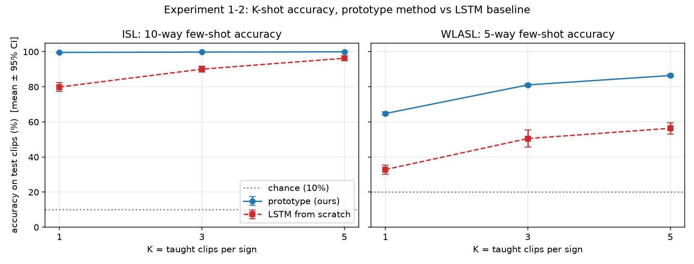
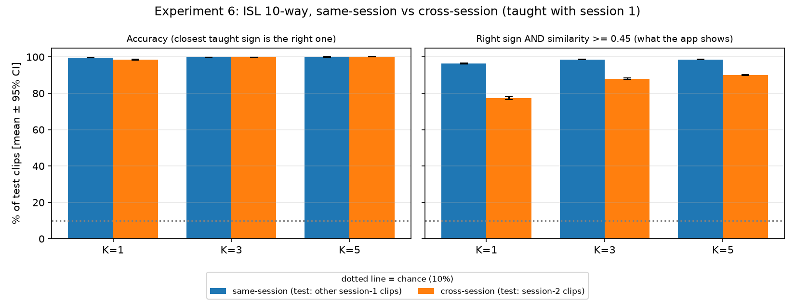

# Sign Language Translator

A web app that translates between hand signs and text, and lets you **teach it new signs
(for example Indian Sign Language) from a handful of webcam clips, without retraining**.

- **Sign → Text**: your webcam streams to a FastAPI WebSocket, MediaPipe Holistic extracts
  543 body/hand/face landmarks, and a pretrained model recognises the sign.
- **Text → Sign**: typed text is tokenised; known words play a reference clip, unknown words
  are fingerspelled.
- **Teach**: record 3-8 clips of a new sign, give it a name, save. It is recognised straight away.

## ASL mode, ISL mode and the Teach feature

| | What it recognises | How |
|---|---|---|
| **ASL mode** (default) | The 250 built-in ASL signs only, exactly like the original app | Pretrained Kaggle model |
| **ISL mode** | Only the signs *you* taught | Few-shot matching (below) |

The two modes never mix. Each result shows its source (built-in or taught) and a confidence
(a probability for built-in, a cosine similarity for taught).

**How teaching works (no retraining).** Just before its final 250-way layer the pretrained
model holds an *embedding*: a 384-number vector describing what was signed. Clips of the same
sign give vectors pointing the same way; different signs do not. To teach a sign we embed your
clips, average them into one *prototype*, and store it in `backend/data/prototypes.json`. To
recognise, we embed the live window and pick the closest prototype if its cosine similarity is
at least `FEWSHOT_THRESHOLD` (0.45). The pretrained model itself is never modified.

**Using the Teach tab**
1. Start the camera and type a sign name.
2. Press *Record clip*: a 3-2-1 countdown, then "Sign now!". Record 3-8 clips (click a clip
   chip to delete a bad one). Keep the camera on until you save.
3. Press *Save sign*. You are asked to confirm if the clips look like a built-in ASL sign, like a
   sign you already taught, or reuse the name of a taught sign.
4. The *Live test* panel shows the closest taught sign, its similarity and the threshold, so
   you can check it works before using ISL mode.

Every saved clip is also kept in `backend/data/eval_clips/<sign>/` (max 8 per sign) so accuracy
can be measured later. **Developer mode** (`http://localhost:5173/?dev=1`) shows
testing-only controls, such as recording a second session of test clips without teaching.

## Key results

Measured with `python -m ml.evaluate` (400 random episodes, fixed seed, test clips never used for
teaching). Full numbers, CSVs and all plots: [backend/results/results.md](backend/results/results.md).

| Test | K=1 | K=3 | K=5 | Chance |
|---|---|---|---|---|
| **ISL, 10 signs**, same session | 99.6% | 99.8% | 100% | 10% |
| **ISL, 10 signs**, taught in session 1, tested on a later session 2 | 98.4% | 99.9% | 100% | 10% |
| ...and the right sign **shown by the app** (similarity ≥ 0.45), cross-session | 77.4% | 88.0% | 90.0% | |
| **WLASL "new" signs**, 5-way, many signers | 64.8% | 81.1% | 86.4% | 20% |
| LSTM trained from scratch on the same clips: ISL | 79.9% | 90.1% | 96.3% | |
| LSTM trained from scratch on the same clips: WLASL | 32.9% | 50.5% | 56.4% | |

K = taught clips per sign. Teaching beats the LSTM baseline everywhere, by most on the
multi-signer WLASL signs. The LSTM numbers come from 25 of the 400 episodes (it is slow to train).

Speed (this laptop CPU): an ISL decision takes about 21 ms per window; with MediaPipe
(43 ms per frame) about 64 ms per frame. Threshold: at 0.45 on ISL, 98.5% of correct signs are
accepted while 3-7% of never-taught signs slip through (17.7% at the old 0.35).





## Run it

**One command (Windows):** `.\start.ps1` starts the backend and frontend and opens
http://localhost:5173. The backend needs about a minute to load TensorFlow and the model, so if
the page shows "Failed to fetch", press F5.

**Manually:**
```bash
cd backend && .venv\Scripts\activate && uvicorn app.main:app --reload --port 8000
cd frontend && npm run dev            # http://localhost:5173
```

### One-time setup
MediaPipe and TensorFlow do **not** support Python 3.13: use 3.12.
```bash
cd backend
py -3.12 -m venv .venv
.venv\Scripts\Activate.ps1
python -m pip install --timeout 180 --retries 10 -r requirements.txt
cd ../frontend && npm install
```
Do not run `pip install --upgrade pip` inside this venv on Windows: pip replacing itself
mid-run leaves a broken `~ip` directory and the venv has to be recreated.

Download the pretrained model (used automatically when present):
```bash
mkdir backend\data\models\islr
curl -L -o backend/data/models/islr/model.tflite https://huggingface.co/sign/kaggle-asl-signs-1st-place/resolve/main/model.tflite
curl -L -o backend/data/models/islr/sign_to_prediction_index_map.json https://huggingface.co/sign/kaggle-asl-signs-1st-place/resolve/main/sign_to_prediction_index_map.json
```
Text → Sign needs reference clips in `backend/data/signs/`, which `python -m ml.fetch_wlasl` downloads.

### Tests and evaluation
| Command | Needs | Covers |
|---|---|---|
| `cd backend && python -m tests.smoke_test` | install only | MediaPipe, LSTM, windowing/debounce, HTTP routes |
| `cd backend && python -m tests.combine_test` | install only | taught-vs-built-in decision rule, smoothing, debounce |
| `cd frontend && npm run test:ui` | model + `data/raw` + Chrome | the React app with a clip as fake webcam |
| `cd frontend && npm run test:teach` | model + `data/raw` + Chrome | Teach tab, ASL/ISL modes, developer mode (uses a throw-away prototypes file) |
| `cd backend && python -m ml.evaluate` | taught clips in `data/eval_clips/` + `data/raw` | all the results above, written to `backend/results/` |
| `cd backend && python -m ml.evaluate --cross-session-only` | also `data/eval_clips_session2/` | just the session-1 → session-2 test; rebuilds `results.md` from the saved CSVs |

The frontend test needs ports 8000 and 5173 free (stop the running app first).
`python -m ml.check_embeddings` checks that the embeddings separate signs; the old LSTM held-out
scorer is `python -m ml.evaluate_lstm`.

### Configuration
Everything is in `backend/config.py`: `FEWSHOT_THRESHOLD` (0.45), `BUILTIN_CONFIDENT` (0.5, the
bar for the "looks like a built-in sign" warning), `SMOOTH_WINDOWS` / `SMOOTH_MIN_WINS` (5 / 3, ISL
smoothing), `FEWSHOT_MIN_CLIPS` / `FEWSHOT_MAX_CLIPS` (3 / 8), `FEWSHOT_EVAL_MAX_CLIPS` (8),
`CONFIDENCE_THRESHOLD` (0.75, built-in "Not sure" cut-off). The Teach tab talks to the backend
over the WebSocket (`mode`, `capture`, `delete_clip`, `clear_clips`, `save`, `save_test`); HTTP
routes `GET /api/prototypes`, `DELETE /api/prototypes/{name}`, `POST /api/teach` and
`GET /api/test-clips` expose the stores.

```
backend/
  app/main.py          FastAPI: HTTP routes + /ws/recognize
  app/library.py       text -> sign lookup + fingerspelling fallback
  ml/landmarks.py      MediaPipe Holistic -> landmarks
  ml/predict.py        sliding-window inference with debouncing (pretrained model)
  ml/fewshot.py        embeddings, prototypes, taught-sign store, eval clips
  ml/combine.py        ISL smoothing and the built-in/taught decision rule
  ml/evaluate.py       the evaluation experiments -> results/
  ml/train.py, collect.py, preprocess.py, fetch_wlasl.py   optional LSTM pipeline (below)
  results/             CSVs, plots and results.md
frontend/              Vite + React
```

### Optional: your own LSTM instead of the pretrained model
Set `SIGN_MODEL=lstm` to use a model trained here (e.g. for words outside the 250).
`python -m ml.fetch_wlasl --top 12` downloads WLASL clips (CC BY-NC 4.0, research use),
`python -m ml.preprocess` turns them into landmark sequences (mirroring and temporal-crop
augmentation, run in parallel), and `python -m ml.train` trains the LSTM (the split is grouped by
source clip so augmented copies never straddle it). Or record your own takes with
`python -m ml.collect <word>`, then train. Accuracy on WLASL's ~14 clips per sign is low; that is
the dataset, not the pipeline. If you change `ml/landmarks.py`, re-run `preprocess --fresh` and
`train`: a model trained on the old layout loads fine but predicts one class for everything.

## Limitations

- **One signer.** The ISL results come from one person. They say nothing about how well other
  people would do on your taught signs.
- **Small test sets.** The ISL cross-session test is 50 clips (5 per sign); the WLASL test is only
  7 new signs with 13-16 clips each. The confidence intervals only reflect *which clips were taught*,
  not new people, lighting or days, so real uncertainty is larger.
- **Later sessions score lower similarity.** The right sign is almost always the closest, but its
  similarity drops from about 0.85 (same session) to about 0.66 (a later session), so at the 0.45
  threshold only 88% of correct signs (K=3) are shown; the rest give "Not sure". A lower threshold
  fixes that but lets more never-taught signs through. Teach with 3-8 clips, ideally from more
  than one sitting.
- **Taught signs can resemble built-in ones.** The app warns when they do; accuracy for new signs
  from other signers is much lower (65-86% on WLASL, 5-way).
- **Not tested:** left-handed signing, other signers on your ISL signs, and different cameras or lighting.
- **The LSTM baseline** is untuned, trained from scratch for 60 epochs, on 25 episodes only; a
  stronger few-shot baseline might do better.
- **Clips are lost if the camera stops** before you press *Save sign*.
- **No continuous-signing segmentation.** The debounce emits a word when confidence crosses the
  threshold, a heuristic rather than a real boundary detector. Text → Sign is a lookup, not
  generation, and ignores ASL grammar.
- Speed figures are for one laptop CPU; the live app adds JPEG decoding and network time.

## Credits

- **Pretrained sign recognition model:** the 1st-place solution of Google's Kaggle
  [ASL Signs](https://www.kaggle.com/competitions/asl-signs) competition, as published on Hugging Face at
  [sign/kaggle-asl-signs-1st-place](https://huggingface.co/sign/kaggle-asl-signs-1st-place) (MIT licence).
  It recognises 250 signs and was trained on ~94k takes by 21 signers.
- **WLASL** word-level ASL videos ([Voxel51/WLASL](https://huggingface.co/datasets/Voxel51/WLASL), CC BY-NC 4.0),
  used for reference clips and for evaluating new signs.
- **MediaPipe Holistic** (Google) for landmark extraction.
